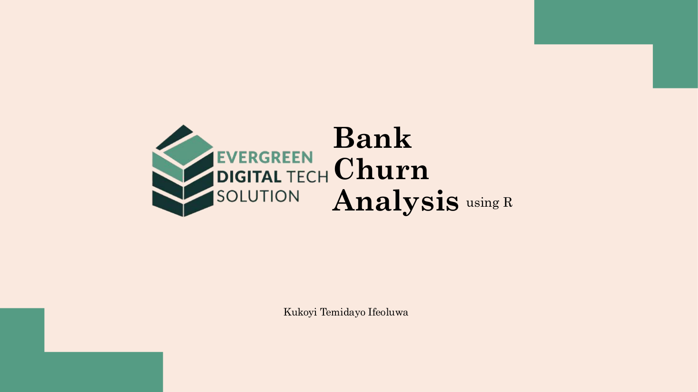
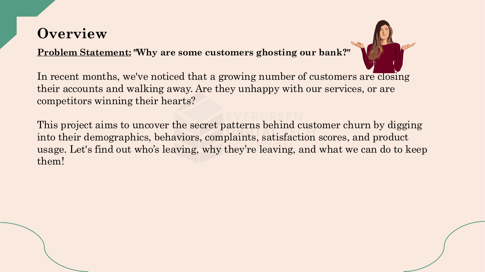
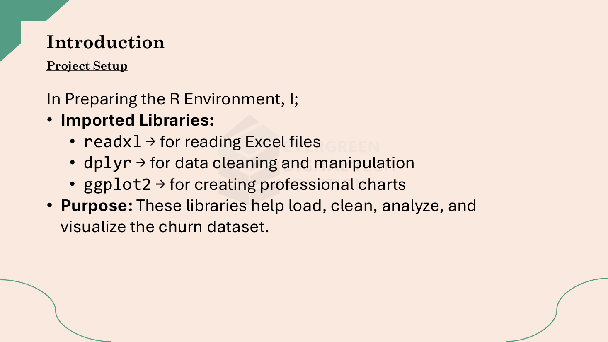
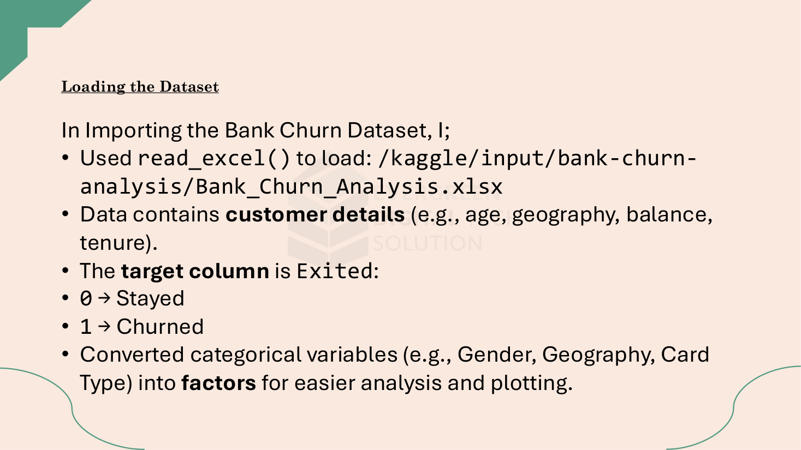
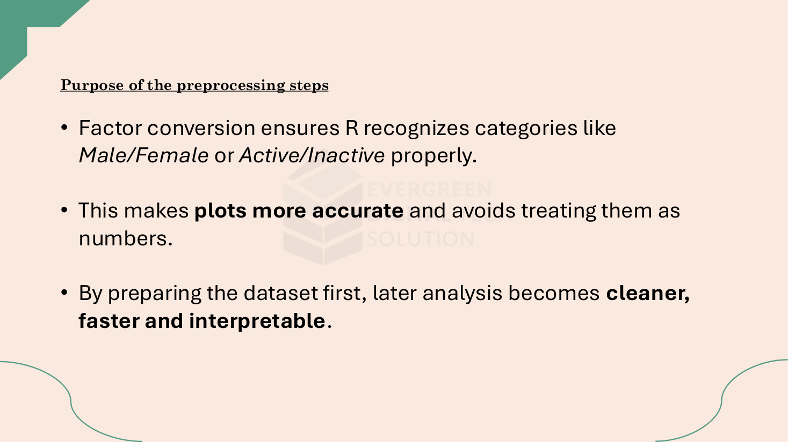
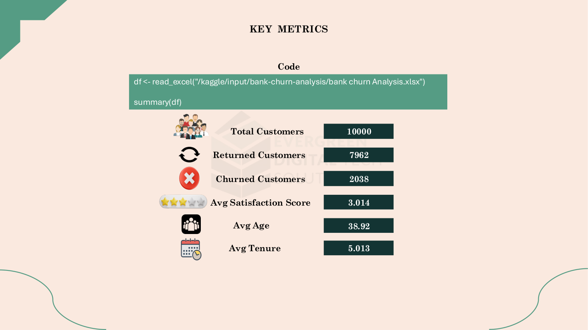
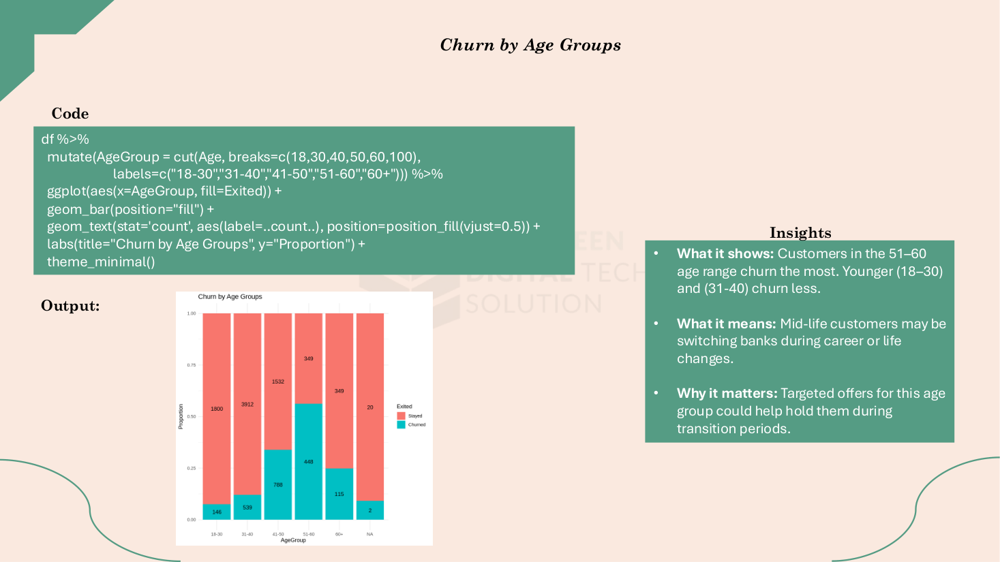
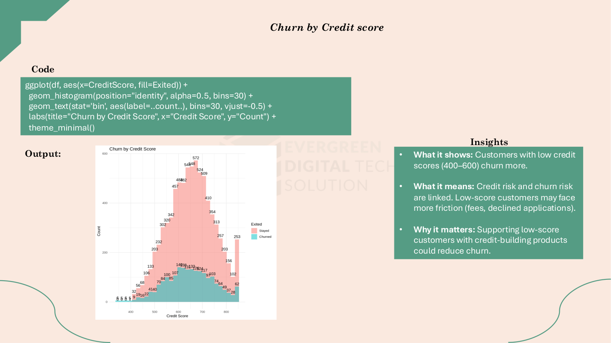
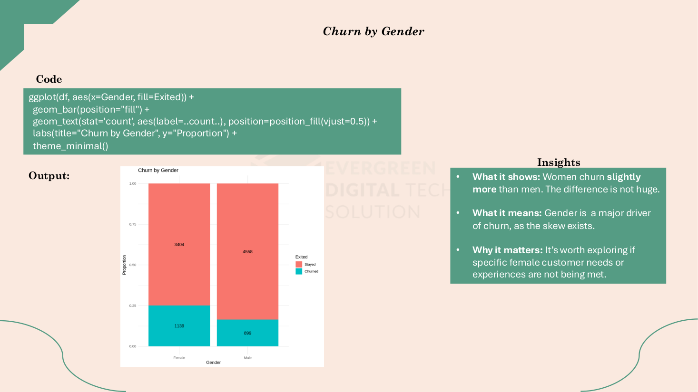

# Bank Churn Analysis: Understanding Why Customers Leave

**Analyzing customer demographics, behavior, complaints, product usage, and engagement to identify patterns associated with bank churn.**

An exploratory analysis of 10,000 banking customers to identify demographic, behavioral, and product-related patterns associated with customer churn.

| | |
|---|---|
| **Field** | Data Analytics |
| **Period** | 2025 |
| **Tools** | R, dplyr, ggplot2, Microsoft Excel |
| **Full case study** | [temidayokukoyi.vercel.app/work/bank-churn-analysis](https://temidayokukoyi.vercel.app/work/bank-churn-analysis) |

## The question

Why are some banking customers leaving, and what patterns can help identify customers who may be at higher risk of churn?

Customer churn is a major concern for banks because losing an existing customer can mean losing future revenue, product usage, and long-term customer value. This project explores customer data to understand how demographics, account behavior, complaints, product ownership, activity, and engagement relate to whether customers stay or leave.

## Objective

The objective was to explore the characteristics associated with customer churn and identify customer groups that may require additional attention from a retention perspective.

The analysis focused on five broad areas:

1. Demographics - age, gender and geography
2. Financial characteristics - credit score, balance and estimated salary
3. Customer relationship - tenure and activity status
4. Product usage - number of products, credit-card ownership and card type
5. Engagement and experience - complaints, satisfaction score and points earned

## Context

The analysis was conducted on a banking customer dataset containing demographic, financial, behavioral, product, and satisfaction information. The target variable, Exited, identifies whether a customer stayed with the bank or churned.

Rather than focusing on a single customer characteristic, the analysis examined multiple dimensions of the customer journey to identify patterns that could be useful for retention strategies.

## The data

The dataset contains 10,000 customer records. Each record represents an individual banking customer and includes demographic, financial, relationship, product, engagement and churn-related information.

The target variable is Exited, where 0 represents customers who stayed and 1 represents customers who churned.

## Data sources

Bank Churn Analysis dataset — Excel workbook

## Method

The analysis was performed in R using readxl for data import, dplyr for data preparation and transformation, and ggplot2 for visualization.

Categorical variables such as gender, geography, card type, and membership status were converted into factors so that they could be handled appropriately during analysis and visualization.

The analysis then used exploratory visualizations to compare churned and retained customers across different demographic, financial, behavioral, product, and engagement characteristics.

Analytical techniques
1. Categorical distribution analysis
2. Proportion-based churn comparisons
3. Histogram analysis
4. Customer segmentation
5. Exploratory data visualization
6. Comparative analysis of churned vs. retained customers

## Analysis process

1. Data import
The Excel dataset was imported into R using readxl.

2. Data preparation
Relevant categorical variables were converted into factors to ensure that variables such as gender, geography, card type, and activity status were interpreted correctly.

3. Target identification
Exited was used as the churn indicator, distinguishing customers who stayed from customers who left.

4. Customer profiling
Key descriptive metrics were calculated, including customer count, churn count, average age, average satisfaction score, and average tenure.

5. Churn segmentation
Customers were compared across age groups, geography, gender, credit score, balance, tenure, product count, card type, credit-card ownership, activity status, complaints, salary, satisfaction score, and points earned.

6. Visualization
Proportion charts and distribution plots were created using ggplot2 to make differences between churned and retained customers easier to identify.

7. Business interpretation
The observed patterns were translated into potential retention actions, focusing on engagement, complaints, tenure, product usage, geography, and customer value.

## What the data showed

### 20.4% — About one in five customers had churned

The dataset contains 10,000 customers, of whom 2,038 had exited and 7,962 remained. This gives an overall churn rate of approximately 20.4%. This baseline provides context for the rest of the analysis: the objective was to understand which customer characteristics were associated with a higher or lower churn pattern within this overall population.nge.

### 51–60 — Churn was highest among customers aged 51–60

The age-group analysis showed that customers aged 51–60 had the highest churn pattern, while younger groups such as 18–30 and 31–40 showed lower churn. The pattern suggests that age should be considered alongside other customer characteristics when developing retention strategies, particularly for customers approaching or within the 51–60 age range

### Germany — Germany showed the highest geographic churn pattern

Among the three geographies analyzed, Germany recorded the highest churn, while France and Spain showed considerably lower churn patterns. The geographic difference indicates that retention performance varies by market. The analysis suggests that customer experience, competition, or other market-specific factors could be investigated further rather than applying one retention strategy across all regions.

### Inactive customers — Customer inactivity emerged as a strong churn signal

Inactive members churned considerably more than active members. The difference was one of the clearer patterns observed across the customer-behavior analysis. Activity can therefore serve as an early warning signal. Monitoring declining engagement, such as reduced transactions or logins, could help identify customers who may need timely re-engagement.

### 3–4 products — Customers holding more products showed higher churn

Customers with 3–4 products displayed higher churn patterns than customers with 1–2 products. The result suggests that simply increasing the number of products held by a customer does not necessarily translate into stronger retention. Product relevance and customer value may be more important than product count alone.

### 318 — Low engagement was associated with higher churn

Among customers in the lowest points-earned group, 318 customers churned compared with 1,182 who stayed. Churn decreased as points earned increased, with only 21 churned customers versus 89 retained customers in the highest points group. The pattern suggests an association between customer engagement and retention. Customers earning fewer points may have weaker engagement with the bank's products or loyalty ecosystem, making early engagement interventions worth exploring.

## Challenges

One challenge was separating meaningful churn signals from variables where the difference between retained and churned customers was relatively small. Not every customer characteristic showed a strong relationship with churn.

For example, satisfaction scores, estimated salary, and credit-card ownership showed relatively similar churn patterns across categories. This made it important not to treat every variable as an equally important churn indicator.

The analysis therefore focused more heavily on variables where the differences between customer groups were more noticeable, such as activity status, complaints, age, geography, number of products, tenure, credit score, balance, card type, and points earned.

## Recommendations

1. Monitor inactivity as an early warning signal

Track changes in customer activity, such as declining transactions or digital engagement, and use these signals to trigger timely re-engagement efforts.

2. Prioritize complaint resolution

Customers who complain should receive timely follow-up because complaint activity was strongly associated with higher churn in the analysis.

3. Develop targeted strategies for mid-tenure customers

Customers with approximately 3–7 years of tenure showed elevated churn patterns. Loyalty offers and personalized engagement could be explored for this segment.

4. Avoid relying on product count alone

Rather than simply encouraging customers to hold more products, banks should focus on whether the products are relevant to individual customer needs and whether customers are receiving clear value from them.

5. Investigate geographic differences

Germany's higher churn pattern warrants deeper investigation into market-specific customer experience, competition, service issues, and product preferences before applying targeted retention strategies.

6. Strengthen engagement programs

Low points-earned customers showed higher churn patterns. Making loyalty benefits easier to understand and providing clearer pathways to earn rewards could encourage greater engagement.

7. Protect high-value customers

Higher-balance customers showed greater churn patterns, suggesting that customer value should not be treated as a guarantee of loyalty. Proactive relationship management may be particularly relevant for this group.

## Outcome

**What came out of it**
A full exploratory analysis in R (dplyr, ggplot2) of 10,000 bank customers, written up as a visual report with seven concrete retention recommendations.

**What it showed**
2,038 of the 10,000 customers had left, a churn rate of about 20.4%. The clearest signals were inactivity, complaints, age (highest among 51–60), geography (Germany well above France and Spain), holding three or four products, mid-tenure, low points earned and higher balances. Satisfaction score, salary and credit-card ownership showed little difference and would be poor churn flags on their own.

**What it supports**
A retention team gets a ranked list of where to look first: inactivity and complaints as early-warning triggers, specific attention for the 51–60 and mid-tenure groups, and a caution against pushing product count as a loyalty tactic.

**Status**
An independent study on a supplied customer dataset, not a bank engagement. The next step would be a predictive model on the same variables and a test of the re-engagement triggers against actual retention.

## In this repository

- `figures/` — the 22 pages of the report rendered as images (`report-page-01.png` …).
- `scripts/bank_churn_analysis.R` — the full R script (readxl · dplyr · ggplot2 · corrplot). Also published as a [Kaggle notebook](https://www.kaggle.com/code/tedsart/edts-bank-churn-analysis).
- `data/bank-churn-Analysis.xlsx` — the workbook used for the analysis.
- `report/Bank-Churn-Analysis.pdf` — written report / dashboard export (PDF).
- `figures/` — 22 dashboard and report screenshots.

## Gallery

_…and 13 more in `figures/`._

## Skills applied

Data Cleaning, Exploratory Data Analysis, Customer Churn Analysis, Statistical Analysis, Data Visualization, Customer Segmentation, R Programming, Business Intelligence

---

**Temidayo Kukoyi** · Data analyst · [temidayokukoyi.vercel.app](https://temidayokukoyi.vercel.app) · [LinkedIn](https://www.linkedin.com/in/temidayo-kukoyi-5a59a7353)
